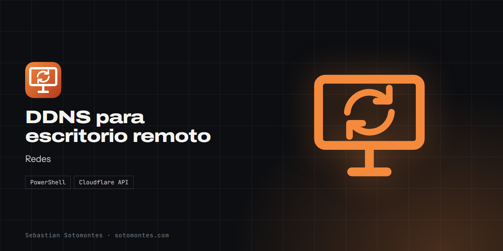
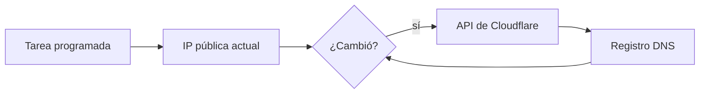

Mantiene un dominio apuntando a una IP dinámica para llegar a un equipo por escritorio remoto.

<a href="https://sotomontes.com/#ddns-para-escritorio-remoto"><b>Ver en sotomontes.com</b></a> · <a href="#cómo-se-usa">Cómo se usa</a> · <a href="#cómo-funciona-por-dentro">Cómo funciona</a> · <a href="#novedades">Novedades</a>

| Ficha técnica | |
|---|---|
| **Autor** | Sebastian Sotomontes |
| **Tipo** | Redes |
| **Plataforma** | Windows, con PowerShell |
| **Versión** | 1.0 |
| **Estado** | Funcional |
| **Stack** | PowerShell · Cloudflare API |
| **Código** | Privado. Esta página es solo una presentación. |

---

## Qué es

Mantiene un nombre de dominio apuntando a una IP pública dinámica, para llegar a un equipo por escritorio remoto sin depender de una IP que cambia.

## Novedades

- Actualiza el registro solo cuando cambia la IP.

## Cómo se usa

1. Crea un token de API de Cloudflare limitado a tu zona.
2. Configura el script con el identificador de la zona y del registro.
3. Prográmalo con el Programador de tareas.
4. Conéctate usando el nombre de dominio.

## Funciones

- **Consulta** tu IP pública.
- **Compara** con el registro DNS activo.
- **Actualiza** solo si cambió.
- **Se programa** con el Programador de tareas.

## Detalles

- El registro debe estar sin proxy, porque el escritorio remoto no es tráfico web.
- Conviene reservar la IP local del equipo.

## Cómo funciona por dentro

### Arquitectura

### Cómo funciona

El script compara la IP pública con el registro activo y solo llama a la API si son distintos, así evita escrituras innecesarias.

---

© 2026 Sebastian Sotomontes. Todos los derechos reservados.
